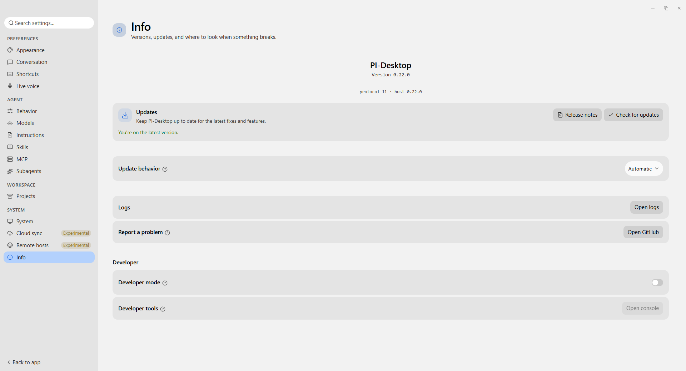
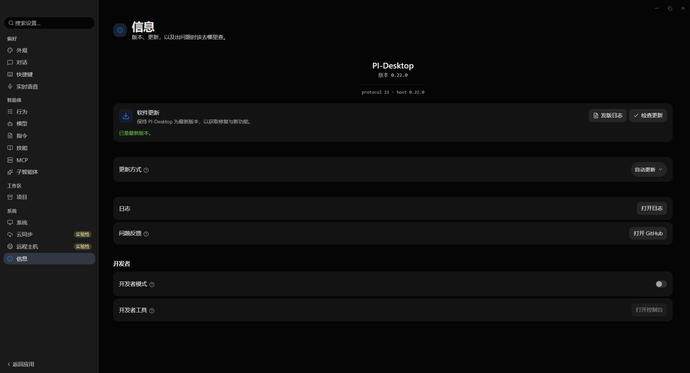

# PI-Mac OS Classic Theme

**English** · [简体中文](README.zh-CN.md)

A theme plugin for [PI-Desktop](https://github.com/vastsa/pi-desktop), ported from
[huacnlee/zed-theme-macos-classic](https://github.com/huacnlee/zed-theme-macos-classic): light and
dark, plus two commands to switch.

<table>
<tr>
<td></td>
<td></td>
</tr>
</table>

## Install

- **Marketplace**: PI-Desktop → Plugins → Marketplace → *macOS Classic Theme* → Install.
- **Package**: download the `.piplug` from [Releases](https://github.com/XELZSSS/PI-Mac-OS-Classic-Theme/releases),
  then Plugins page → Install package.
- **Development**: Plugins → Load dev plugin → this repository.

## Usage

Switch in Settings → Appearance, or run `macOS Classic: Apply Light Theme` /
`macOS Classic: Apply Dark Theme` from the command palette.

## Scope and permissions

It restyles PI-Desktop's own window; system appearance, accent colour and other applications are
untouched, and no setting other than the theme preference is written.

| Permission | Use |
| --- | --- |
| `ui.theme` | Register and inject the two theme sheets. |
| `ui.window.appearance` | Set the native window background (`#f2f2f2` light, `#050505` dark). |

No `fs.*`, no `net.*`, no clipboard, no agent tools, no background service, no stored data.
Uninstalling removes the code, the theme sheets and the preference pointing at them.

## Colours

- Dark: page `#050505`, panels `#1a1a1a`, hover `#2e2e2d`
- Light: page `#f2f2f2`, panels `#e4e4e4`, white composer
- Shadows are disabled; depth comes from fills and 1px borders, with 0.5px hairlines on floating surfaces

## Development

`PluginCheck` validates the plugin, `PluginPack` writes `dist/<id>-<version>.piplug`. Editing the
CSS in a directory-loaded copy hot-reloads the theme.

## License

MIT · [LICENSE](LICENSE) · palette © Jason Lee (huacnlee)
