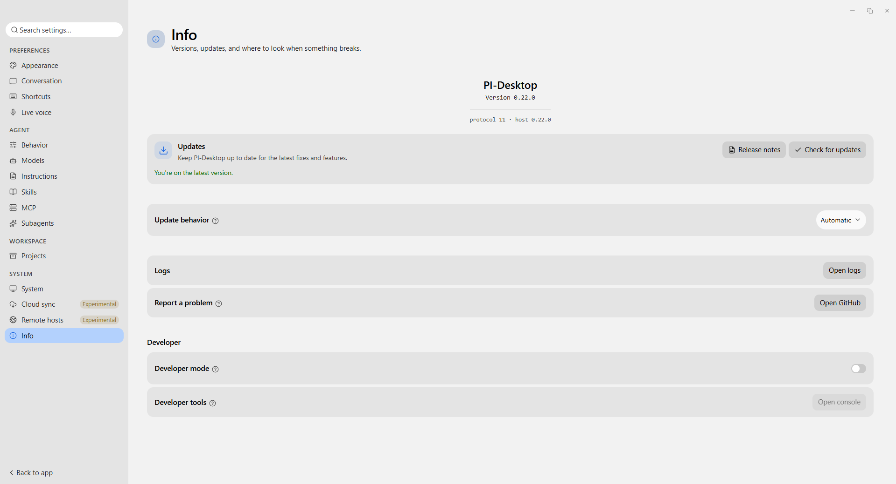
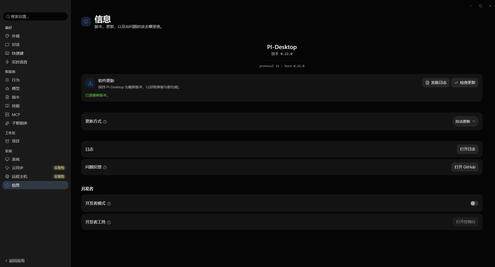

# PI-Mac OS Classic Theme

[English](README.md) · **简体中文**

面向 [PI-Desktop](https://github.com/vastsa/pi-desktop) 的主题插件，移植自
[huacnlee/zed-theme-macos-classic](https://github.com/huacnlee/zed-theme-macos-classic)：浅色与深色
两套，附两个切换命令。

<table>
<tr>
<td></td>
<td></td>
</tr>
</table>

## 安装

- **市场**：PI-Desktop → 插件 → 市场 → 「macOS 经典主题」→ 安装。
- **安装包**：从 [Releases](https://github.com/XELZSSS/PI-Mac-OS-Classic-Theme/releases) 下载 `.piplug`，
  在插件页选择「安装插件包」。
- **开发**：插件页 → 加载开发插件 → 本仓库。

## 使用

在设置 → 外观中切换，或在命令面板执行 `macOS Classic: Apply Light Theme` /
`macOS Classic: Apply Dark Theme`。

## 影响范围与权限

只改 PI-Desktop 自己的窗口：系统外观、强调色与其它应用不受影响，除主题偏好外不写入任何设置。

| 权限 | 用途 |
| --- | --- |
| `ui.theme` | 注册并注入两套主题样式表。 |
| `ui.window.appearance` | 设置原生窗口背景色（浅色 `#f2f2f2`，深色 `#050505`）。 |

没有 `fs.*`、没有 `net.*`、不碰剪贴板、没有 Agent 工具、没有后台常驻服务、不存数据。卸载即连同代码、
样式表与指向它们的偏好一起清除。

## 配色

- 深色：页面 `#050505`，面板 `#1a1a1a`，悬停 `#2e2e2d`
- 浅色：页面 `#f2f2f2`，面板 `#e4e4e4`，输入框为白色
- 阴影禁用，层次由填充与 1px 描边承担，浮层用 0.5px 发丝边

## 开发

`PluginCheck` 校验插件，`PluginPack` 生成 `dist/<id>-<version>.piplug`。以目录方式加载时改 CSS 即热更新。

## 许可证

MIT · [LICENSE](LICENSE) · 配色数据 © Jason Lee (huacnlee)
