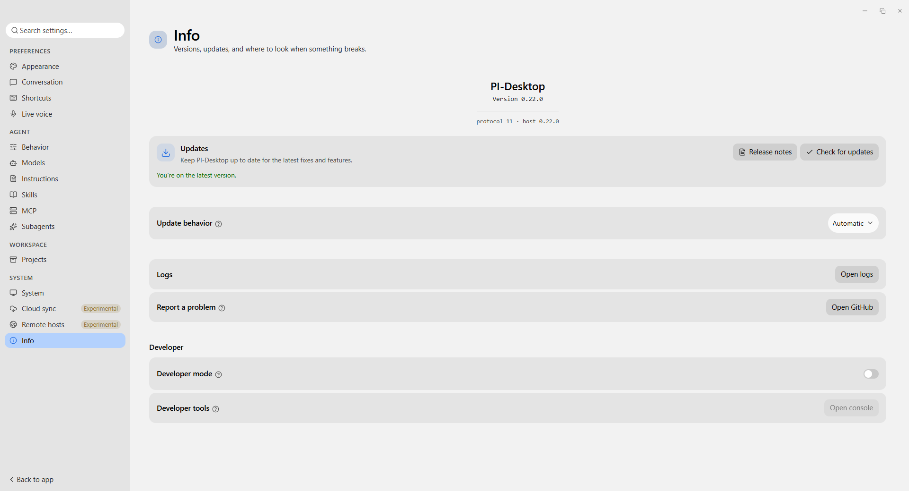
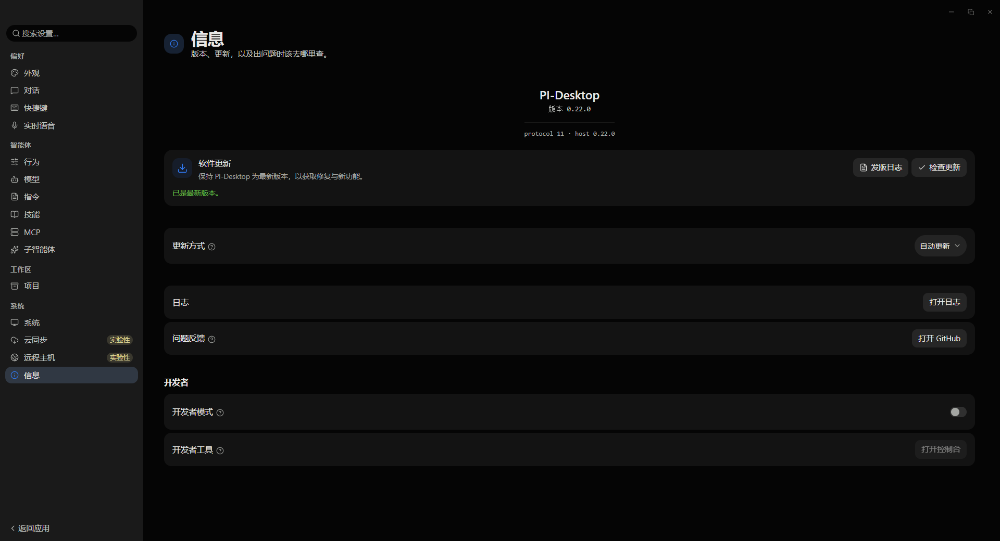

# PI-Mac OS Classic Theme

[English](README.md) · **简体中文**

面向 [PI-Desktop](https://github.com/vastsa/pi-desktop) 客户端的主题插件，移植自
[huacnlee/zed-theme-macos-classic](https://github.com/huacnlee/zed-theme-macos-classic)，
含浅色与深色两套主题

<table>
<tr>
<td></td>
<td></td>
</tr>
</table>

## 项目架构预览

```text
PI-Mac OS Classic Theme/
├── manifest.json   # 插件清单
├── main.js         # 插件入口
├── themes/         # 浅色与深色主题样式表
├── dist/           # 打包产物
├── README*.md      # 文档
└── LICENSE
```

## 使用

从 [Releases](https://github.com/XELZSSS/PI-Mac-OS-Classic-Theme/releases) 下载 `.piplug`，
在插件页选择“安装插件包”

在设置 → 外观中切换，或执行命令 `macOS Classic: Apply Light Theme` / `Apply Dark Theme`

## 说明

- 深色页面 `#050505` / 面板 `#1a1a1a`；浅色页面 `#f2f2f2` / 面板 `#e4e4e4`，输入框为白色
- 阴影禁用，层次由填充与 1px 描边承担

## 许可证

MIT · [LICENSE](LICENSE) · 配色数据 © Jason Lee (huacnlee)